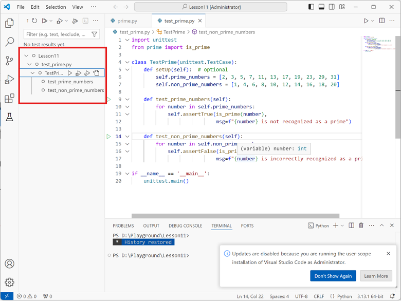
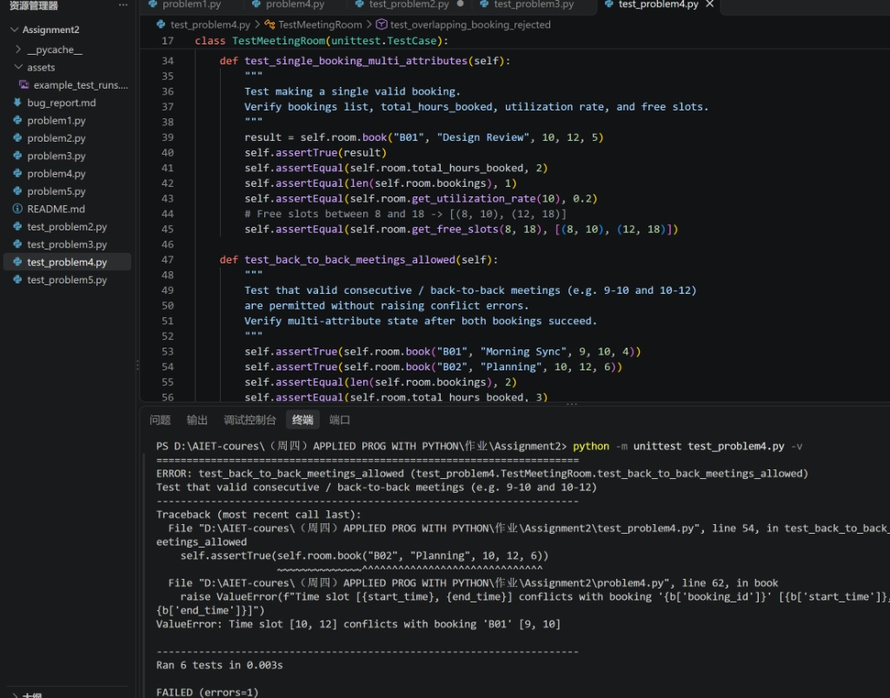

# Bug Report

This report documents the bugs discovered in the buggy programs, including the failing test cases, root cause analysis, and the applied code fixes.

---

## Bug Report 1: (Example)

### 1. Program Under Test
- **File:** `problemX.py`
- **Class / Function:** `YourClassName.method_name()`

### 2. Failing Test Case
Provide the unit test code from `test_problemX.py` that exposed the bug and failed during execution:

```python
# Paste your failing test method here
def test_example_failure(self):
    pass
```

Provide the captured test runs from VSCode.



**Test Output / Error Message:**
```text
# Paste error traceback / assertion failure message here
```

### 3. Root Cause Analysis
Explain why the bug occurred and what incorrect behavior it caused:
- **Expected Behavior:** (What should happen according to the specifications)
- **Actual Behavior:** (What happened in the starter code)
- **Root Cause:** (Explanation of the bug in the code logic)

### 4. Code Fix & Diff
Show the changes made to `problemX.py` to fix the bug:

```diff
- # Original buggy code line
+ # Corrected code line
```

---


## Bug Report 2: Problem 4 - Consecutive / Back-to-Back Booking Conflict Bug

### 1. Program Under Test
- **File:** `problem4.py`
- **Class / Function:** `MeetingRoom.book()`

### 2. Failing Test Case
UnitTest in `test_problem4.py` testing consecutive time slot bookings:

```python
def test_back_to_back_meetings_allowed(self):
    self.assertTrue(self.room.book("B01", "Morning Sync", 9, 10, 4))
    self.assertTrue(self.room.book("B02", "Planning", 10, 12, 6))

Provide the captured test runs from VSCode.


**Test Output / Error Message:**
```text
ERROR: test_back_to_back_meetings_allowed (test_problem4.TestMeetingRoom.test_back_to_back_meetings_allowed)
Traceback (most recent call last):
  File "test_problem4.py", line 54, in test_back_to_back_meetings_allowed
    self.assertTrue(self.room.book("B02", "Planning", 10, 12, 6))
  File "problem4.py", line 62, in book
    raise ValueError(f"Time slot [{start_time}, {end_time}] conflicts with booking '{b['booking_id']}' [{b['start_time']}, {b['end_time']}]")
ValueError: Time slot [10, 12] conflicts with booking 'B01' [9, 10]

### 3. Root Cause Analysis
Explain why the bug occurred and what incorrect behavior it caused:
- **Expected Behavior:** Booking 9-10 and 10-12 back-to-back should be permitted without raising conflict errors as they touch only at boundary 10.
- **Actual Behavior:** Booking 10-12 raised a ValueError conflict with existing booking 9-10.
- **Root Cause:** Strict inequality operators (< and >) were used in conflict checking logic instead of non-strict inequalities (<= and >=), falsely flagging adjacent time slots as overlapping.

### 4. Code Fix & Diff
Show the changes made to `problem4.py` to fix the bug:
```diff
- # Original buggy code line
  if not (end_time < b["start_time"] or start_time > b["end_time"]):
+ # Corrected code line
+ if not (end_time <= b["start_time"] or start_time >= b["end_time"]):


---

## Bug Report 3: Problem 5 - Swapped Aggregation Logic (min / max)

### 1. Program Under Test
- **File:** `problem5.py`
- **Class** / Function:** clean_and_aggregate()

### 2. Failing Test Case
UnitTest in test_problem5.py testing min and max aggregations:

```python

def test_aggregate_min_and_max(self):
    min_result = clean_and_aggregate(self.sample_sales, group_by="region", metric="sales", aggregation="min")
    max_result = clean_and_aggregate(self.sample_sales, group_by="region", metric="sales", aggregation="max")
    self.assertAlmostEqual(min_result["North"], 100.0)
    self.assertAlmostEqual(max_result["North"], 200.0)

Provide the captured test runs from VSCode.
.jpg)

**Test Output / Error Message:**
```text
FAIL: test_aggregate_min_and_max (test_problem5.TestDataAggregator.test_aggregate_min_and_max)
AssertionError: 200.0 != 100.0 within 7 places (100.0 difference)

### 3. Root Cause Analysis
Explain why the bug occurred and what incorrect behavior it caused:
- **Expected Behavior:** aggregation="min" should return the minimum metric value (100.0), and aggregation="max" should return the maximum (200.0).
- **Actual Behavior:** aggregation="min" returned 200.0 and failed assertion.
- **Root Cause:** The function calls for min and max were inadvertently swapped in the implementation (min called max() and max called min()).

### 4. Code Fix & Diff
Show the changes made to `pproblem5.py` to fix the bug:
```diff

- # Original buggy code line
 elif agg_op == "min":
     val = max(values)
 elif agg_op == "max":
     val = min(values)

+ # Corrected code line
+ elif agg_op == "min":
+     val = min(values)
+ elif agg_op == "max":
+     val = max(values)

## Bug Report 4: Problem 5 - Missing Empty Dataset Validation
### 1. Program Under Test
- **File:**problem5.py
- **Class** / Function:** clean_and_aggregate()

### 2. Failing Test Case
UnitTest in test_problem5.py testing empty dataset handling:

```python

def test_empty_dataset_raises_value_error(self):
    with self.assertRaises(ValueError):
        clean_and_aggregate([], group_by="region", metric="sales")

Provide the captured test runs from VSCode.
.jpg)

**Test Output / Error Message:**
```text
FAIL: test_empty_dataset_raises_value_error (test_problem5.TestDataAggregator.test_empty_dataset_raises_value_error)
AssertionError: ValueError not raised

### 3. Root Cause Analysis
Explain why the bug occurred and what incorrect behavior it caused:
- **Expected Behavior:** Passing an empty list [] as records should raise a ValueError.
- **Actual Behavior:** The function returned an empty dictionary {} without raising ValueError.
- **Root Cause:** The function lacked input validation for empty records lists.

### 4. Code Fix & Diff
Show the changes made to `problem5.py` to fix the bug:
```diff
- # Original buggy code line
valid_aggregations = {"sum", "mean", "min", "max", "count"}
  agg_op = aggregation.lower()

+ # Corrected code line
+ if not records:
     raise ValueError("records list cannot be empty")
